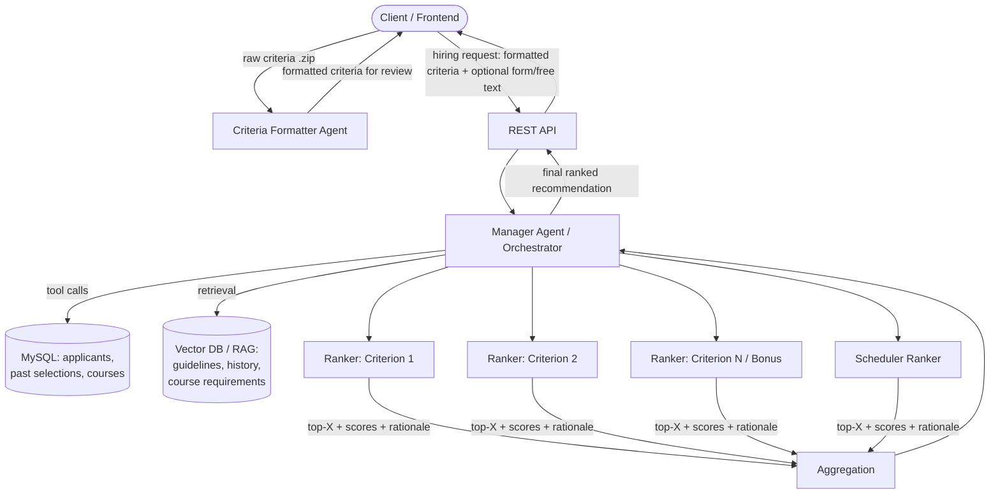

# Architecture
Concept: Instead of developing a machine learning model, we will be implementing AI agents to consume provided data and collaborate to output a “ranking system” to organize the best candidates. This implementation takes advantage of more modern technologies thus exposing us to tools we are likely to encounter in the field and will provide us with a strengthened understanding of them. Additionally, we aim for our shipped agentic AI methodology to be generalized enough that it could easily fit into other hiring optimization solutions if provided with the required input. 

List of Agents 
---
Manager Agent (Orchestrator): 
- Input --> Understand hiring request --> Determine workflow --> Call appropriate agents/tools --> Validate outputs --> Handle failures --> Send results to final aggregation --> Return final recommendation 
- NOTE: Manager will require input in PRE-DETERMINED formatting 
- Manager can also optionally receive more specified instructions through form, free text, etc. 
- We can make a form with an option for additional free-text section at the end to determine weighting and other priorities 

- Clients should do one of the following 
--make an api call to CRITERIA FORMATTER AGENT where they can pass a zip file of hiring criterion related content which will be scanned by the agent which will format the data to our desired formatting. They can also personally review the output of the agent to ensure information was not malformed or lost 
--Fill in a file that provides our desired formatting structure (either manually or having their own internal resources access and format their data. 

Criteria Formatter Agent – Requirements parser 
- Unzips any data provided 
- Converts data in any format to some machine-readable format that the manager is expecting like json, csv etc. 
- Splits all data into specific criteria's (identifying registered criterion from bonus criterion) 
- Hashes/excludes any identified sensitive data – id numbers, etc. UCID doesn’t serve ranking purposes so it doesn’t need to be provided to an LLM 

Ranker Agents: 
- Instead of agent just finding something to do  
- Instead: have a criterion registry 
- Each criteria has a standardized interface that will define for the agent what it is looking for and what it is ranking for 
- If a criterion is not provided, that agent should “sleep” -- recieve not input, provide no output. 
- Have 10 BONUS agents for potential 
- Idea: maybe it could be possible for the user to create criterion that fill in these factors 
- each ranker will spit out top x candidates with some formatting: 

Specialized Ranking Agent – The Scheduler 
- May require sub-agents for this somewhat complex task 
- Needs to receive COURSE scheduling info from Manager 
- Needs to receive CANDIDATE availability info from Manager 
- Needs to consider soft and hard constraints – can be discerned from hiring instructions form/free-text 
--i.e. hard constraint: MUST be available for all scheduled days 
---Exclude candidates who don’t meet this 
-- i.e. soft constraint: Prefer availability for all scheduled days, 2/3 is still alright 
---Don't exclude candidates who don’t meet this, but rank higher if completely available 

 
<!--
  The "how" of the system. Update this whenever the structure changes meaningfully.
  Aim for enough detail that a new teammate could find where to make a change.
-->

## Overview
A client calls our REST API with a hiring request. If the hiring criteria aren't already in our standard format, the **Criteria Formatter Agent** converts them first and the client reviews the result. The **Manager Agent** reads the formatted request and any free-text instructions or weightings, then decides which **Ranker Agents** are needed. It fetches candidate data from the sponsor database through tool functions (and supporting context through RAG) and sends each active ranker only the data for its criterion. It validates their outputs and combines them in an **Aggregation** step into one weighted, explained ranking that goes back to the client.



## Components
These summarize the agent list above. Proposed code locations are **TBD** until the repo structure is set up.

| Component | Responsibility | Input | Output |
|---|---|---|---|
| REST API layer | Public entry point; authenticates the client, validates the request schema, and starts the agent run. Local FastAPI version in `src/hiring_agents/api.py` (no auth yet), wrapping the service layer | HTTP request | Final ranking (JSON) |
| Criteria Formatter Agent | Unzips files, parses any format into our criteria schema, separates registered from bonus criteria, removes or hashes sensitive data | `.zip` / documents | Formatted criteria (JSON) for client review |
| Manager Agent | Interprets the request, picks the workflow, calls rankers and tools, validates outputs, handles failures. Current split: an LLM step drafts the request from free text and supporting documents such as a course outline or job description (a weight for every criterion, instructions per ranker, and weekly sessions for the Scheduler; reviewed by the client; `drafting.py`, `documents.py`, `llm_agents/manager.py`), and the orchestrator runs it in plain code | Formatted criteria, form/free text, supporting documents | Final recommendation |
| Criterion Registry | Defines each criterion's standard interface (what to look for, how to score) and maps criteria to rankers | Criterion definitions | Registered rankers |
| Criteria Planner | Once per dataset (when candidate data is compiled), designs the criteria it can be ranked on: fits fields into the built-in criteria and groups the rest into auto criteria covering one or more fields, with a rubric, importance, course scope and a note per field for the ranker; skips availability and irrelevant fields. Sees field names, column headers and shared category values only. Validated by plain code; saved as an editable catalog | Field profiles, built-in criteria, hiring purpose | `CriteriaCatalog` (`criteria.json`) |
| Ranker Agents | One per registered criterion; sleep when their criterion isn't in the request. Up to 10 bonus slots for client-defined criteria | Candidate data relevant to one criterion | Top-X candidates with score + rationale |
| Scheduler (specialized ranker) | Matches candidate availability to course schedule under hard and soft constraints; may use sub-agents | Course schedule (`HiringRequest.sessions`, which the Manager extracts from a course outline in the same day/time format as candidate `availability`), candidate availability, constraints | Filtered + ranked candidates |
| Aggregation | Combines ranker outputs using client weightings into one ranking (part of the Manager or a separate step: **TBD**) | All ranker outputs + weights | Final ranked list with explanations |
| Data access tools | Python functions exposed to agents as tools for querying MySQL | Query parameters | Structured records |
| RAG store | Vector DB holding selection guidelines, historical selections, course requirements | Text query | Relevant context snippets |

## Data Flow
1. **Criteria intake.** The client either fills in our criteria template directly, or sends a `.zip` to the Criteria Formatter Agent and reviews or approves the formatted output.
2. **Request.** The client sends the formatted criteria plus optional form fields and free text (weightings, hard and soft constraints) to the API.
3. **Planning.** If the client wrote free text or attached documents (course outline, job description), the Manager LLM first drafts the weights and per-ranker instructions from them, and pulls out the sessions to cover for the Scheduler; the client reviews the draft. The Manager then parses the request, looks up which criteria are present in the Criterion Registry, and activates only the matching rankers. The data's criteria catalog, planned by the Criteria Planner when the data was compiled, adds the data's fields to those criteria and lets auto criteria that apply to the role join, so data with any column names can be ranked.
4. **Data retrieval.** The Manager (or the rankers through tools) pulls candidate and course data from MySQL and supporting context from the RAG store. Until the database is connected, candidate data comes from the sponsor's Excel/CSV files, compiled and merged by ID into one local JSON store (`candidate_data/candidates.json`). **Intake** maps the source columns onto the standard field catalog, keeping only the ID and the fields the active criteria need; sensitive and unrecognized columns are dropped and the ID is replaced with a ref before any data reaches an LLM. Criteria with no data are skipped.
5. **Ranking.** Each active ranker scores candidates on its own criterion. The Scheduler applies hard constraints (exclude candidates) and soft constraints (adjust scores).
6. **Validation.** The Manager checks each ranker output against the schema and retries or flags any that fail.
7. **Aggregation.** Scores are combined using the client's weights into one ranking with a per-candidate explanation.
8. **Response.** The final ranking is returned to the client to display to their users. Logging and storage of results is **TBD**.

## Data Model
Draft schemas, to be finalized once the team has seen the sponsor's MySQL schema.

**Criterion (registry entry)**
```json
{
  "id": "teaching_experience",
  "type": "registered | bonus",
  "description": "What the ranker looks for",
  "scoring_guidance": "How to score / what counts as strong vs weak",
  "constraint": "hard | soft | none",
  "weight": 0.25
}
```

**Candidate (as sent to LLMs, with sensitive fields removed)**
```json
{
  "candidate_ref": "hashed-or-internal-id",
  "fields": { "...": "only fields needed by active criteria" }
}
```

**Ranker output** (fills the "some formatting" placeholder in the agent list above)
```json
{
  "criterion_id": "teaching_experience",
  "ranked": [
    { "candidate_ref": "abc123", "score": 0.92, "rationale": "Short evidence-based explanation" }
  ],
  "excluded": [
    { "candidate_ref": "def456", "reason": "Failed hard constraint: unavailable Tue/Thu" }
  ]
}
```

**Final recommendation**
```json
{
  "request_id": "...",
  "ranking": [
    { "candidate_ref": "abc123", "total_score": 0.87, "per_criterion": { "...": 0.9 }, "summary": "..." }
  ],
  "warnings": ["e.g. criterion X had no data for 3 candidates"]
}
```

## External Services & Configuration
- **LLM providers:** OpenAI GPT models (primary, through the Agents SDK). Anthropic Claude models are being evaluated as an alternative through the SDK's non-OpenAI model support. Models may differ per agent based on quality, latency, token usage and cost.
- **MySQL:** sponsor-provided applicant, previous-selection and course data.
- **Vector DB:** for RAG (product **TBD**).
- **Environment variables** (in `environment_vars.env`, which is gitignored):
  - `OPENAI_API_KEY`
  - `ANTHROPIC_API_KEY` (if Claude models are used)
  - Database connection settings (**TBD**)
- **Costs and limits:** each request makes several LLM calls (Manager, active rankers, aggregation). Track token usage per agent during model evaluation.

## Key Design Decisions
| Decision | Rationale | Date / Decided by |
|---|---|---|
| Agentic AI (multi-agent) instead of training an ML model | Uses modern tools common in industry; more flexible for new criteria; no labelled training data needed | TBD |
| OpenAI Agents SDK for orchestration | Sponsor's preferred platform; supports tools, handoffs, and non-OpenAI models | TBD |
| Criterion Registry with standard interface | Rankers have a fixed, well-defined job instead of open-ended tasks; makes the system generic beyond TA hiring | TBD |
| Inactive rankers sleep | Avoids wasted LLM calls and irrelevant output | TBD |
| Fixed input format, with an optional Formatter Agent | Keeps the Manager predictable; the client can check the formatted output for lost or malformed data | TBD |
| Remove or hash sensitive IDs (e.g. UCID) before LLM calls | IDs don't help ranking; reduces privacy exposure | TBD |

## Security & Privacy
- API keys live only in `environment_vars.env` (gitignored) and are never committed or logged.
- Personal identifiers (UCID, student numbers, contact info) are removed or hashed before any data reaches an LLM. The mapping back to real identities stays on our side.
- Send each ranker only the fields its criterion needs (data minimization).
- Applicant data is sent to third-party LLM providers. Confirm with the sponsor and the university privacy office that this is allowed, and check the providers' data-retention settings.
- Using protected characteristics (e.g. ethnicity, sex) as ranking factors would likely conflict with human-rights law and university hiring policy. Review this with the sponsor and the university before any design work. See [ROADMAP.md](ROADMAP.md#risks--open-questions).
- Client authentication for the API: **TBD**.
